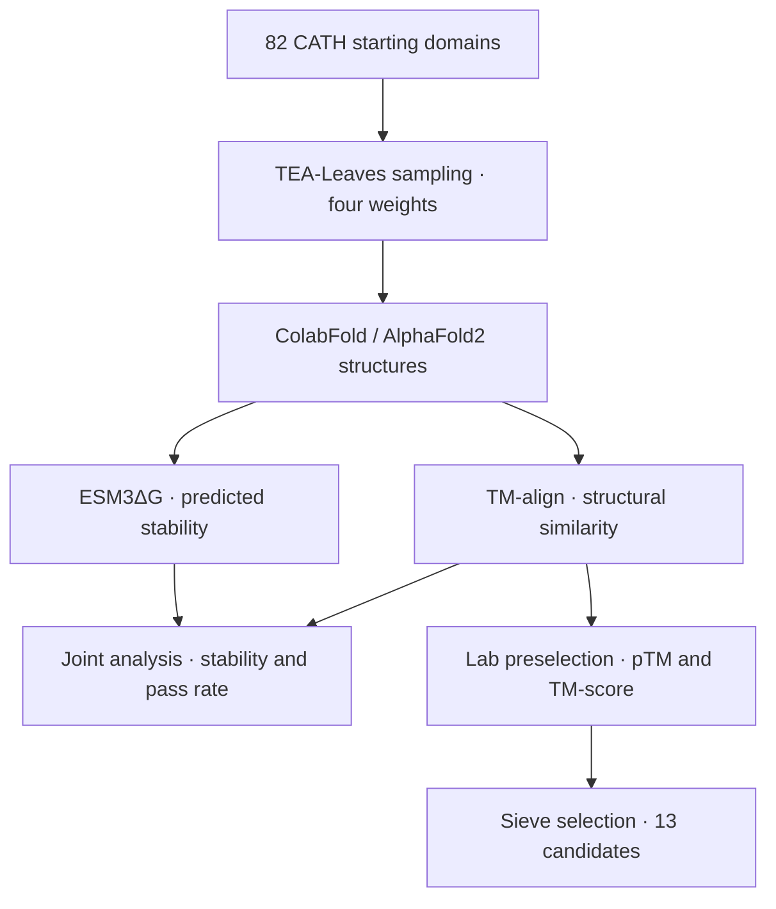

# Computational Protein Design
### Finding the balance between predicted stability and structural similarity

**Mahedi Khan · Matura thesis 2026**  
Research carried out with the Schwede Group · Biozentrum, University of Basel

[Key result](#key-result) · [Workflow](#workflow) · [Explore the study](#explore-the-study) · [Project context](#project-context)

---

| **82** | **32,800** | **4** | **13** |
| :---: | :---: | :---: | :---: |
| CATH starting domains | Design trajectories | Stability weights tested | Candidates selected for lab testing |

## The challenge

Increasing a protein-design model's stability pressure can also push its output away from the target structure. This study tests **which setting improves predicted protein stability while keeping the shape close to the original**.

TEA-Leaves was evaluated at `w_stab ∈ {0, 0.001, 0.01, 0.1}`, with 100 trajectories per starting domain and condition.

## Key result

> **The best observed compromise was `w_stab = 0.01`.**  
> Mean predicted abs_dG: **2.743 → 3.366 kcal/mol**  
> Structure-filter pass rate: **4.43% → 4.27%**
>
> At `0.1`, mean predicted stability rose further, but only **1.87%** of designs passed the structure filter.

“Best compromise” refers to the highest sum of z-standardized predicted stability and pass rate among these four groups. It is specific to the study's configuration and scoring rule.

<strong>View all four parameter settings</strong>

| Stability weight | Designs passing TM-score ≥ 0.7 | Pass rate | Mean abs_dG¹ (kcal/mol) | Compromise score |
| :--- | ---: | ---: | ---: | ---: |
| `0` · control | 363 / 8,200 | 4.43% | 2.743 | −0.038 |
| `0.001` | 354 / 8,200 | 4.32% | 2.665 | −0.198 |
| **`0.01`** | **350 / 8,200** | **4.27%** | **3.366** | **+0.268** |
| `0.1` | 153 / 8,200 | 1.87% | 6.029 | −0.032 |

¹ Predicted stability among designs passing the structure filter; not a measured melting temperature.

The control-versus-`0.01` comparison used 21 paired starting-domain means after filtering: two-sided Wilcoxon `p = 0.0002928` (uncorrected). This test concerns the selected subset, not all 82 domains.

## Workflow

**Inside sampling:** ESM2 sequence plausibility, TEA-alphabet similarity and the internal stability term.  
**After sampling:** ESM3ΔG provides an additional model-based assessment; it is not the Monte-Carlo objective or an experimental measurement.

## From computation to the lab

| Stage | Criterion or outcome |
| :--- | :--- |
| Main structure analysis | TM-score ≥ 0.7 against the starting structure |
| Separate lab preselection | pTM > 0.7 and TM-score > 0.7; 144 designs submitted |
| Additional Sieve selection | 13 designs from 3 starting domains |
| Experimental validation | Pending in the thesis version dated 31 October 2026 |

A higher predicted stability score does not by itself establish a higher melting temperature, retained function or successful expression.

## Explore the study

| Resource | Contents |
| :--- | :--- |
| [Starting sequences](https://github.com/mahedikhan08/Maturarbeit_Mahedi-Khan_2026/tree/main/cath_database) | 82 CATH starting domains |
| [Design sequences](https://github.com/mahedikhan08/Maturarbeit_Mahedi-Khan_2026/tree/main/results/Sequences/01_all_designs_32800) | Sequences from the 32,800 design trajectories |
| [Analysis results](https://github.com/mahedikhan08/Maturarbeit_Mahedi-Khan_2026/blob/main/results/analysis_results.txt) | Wilcoxon tests and compromise scores |
| [Figures](https://github.com/mahedikhan08/Maturarbeit_Mahedi-Khan_2026/tree/main/results/Plots) | Stability, structural similarity and sequence-level comparisons |
| [Secondary structure](https://github.com/mahedikhan08/Maturarbeit_Mahedi-Khan_2026/tree/main/results/Secondary_Structure) | Structural composition data and figures |
| [Lab candidates](https://github.com/mahedikhan08/Maturarbeit_Mahedi-Khan_2026/tree/main/results/Sequences/04_final_lab_13) | 13 sequences selected for experimental testing |
| [Job generation](https://github.com/mahedikhan08/Maturarbeit_Mahedi-Khan_2026/tree/main/utils/generate_scripts) | Python scripts for cluster workflows |
| [Plotting](https://github.com/mahedikhan08/Maturarbeit_Mahedi-Khan_2026/tree/main/utils/plot_scripts) | Analysis and visualization scripts |
| [SLURM files](https://github.com/mahedikhan08/Maturarbeit_Mahedi-Khan_2026/tree/main/utils/submission_files) | Submission scripts and configuration |

<strong>Secondary structure: what changes at high stability pressure?</strong>

The thesis reports a mean helix fraction of **28.71%** in the control, **29.36%** at `0.01` and **50.44%** at `0.1` across all designs. At the highest weight, the predicted proteins contained much more helical structure.

[Explore the secondary-structure results](https://github.com/mahedikhan08/Maturarbeit_Mahedi-Khan_2026/tree/main/results/Secondary_Structure).

## Reproducibility

The TEA-Leaves core is not publicly available. This repository documents the study and shares scripts, sequences and results; it does not provide a standalone installation for reproducing the complete design process. Cluster paths, environments and SLURM settings require adaptation.

## Project context

**Author:** Mahedi Khan · Gymnasium Liestal · Matura thesis, 2026  
**Research context:** Schwede Group, Biozentrum, University of Basel  
**Scientific supervision:** Dr. Gabriel Studer and Dr. Janani Durairaj  
**School supervision:** Dr. Christian Freiburghaus

TEA-Leaves and its stability-term extension were provided by the research group. This project's contribution is pipeline deployment on sciCORE, workflow automation, systematic parameter evaluation, structural filtering and statistical analysis. Thanks to Lorenzo Pantolini and Ieva Pudžiuvelytė for their support and candidate-selection work. AI assistance in coding and debugging is documented in Chapter 8 and Appendix E of the thesis.

[MIT license](https://github.com/mahedikhan08/Maturarbeit_Mahedi-Khan_2026/blob/main/LICENSE) · Third-party software and models retain their own licenses.

